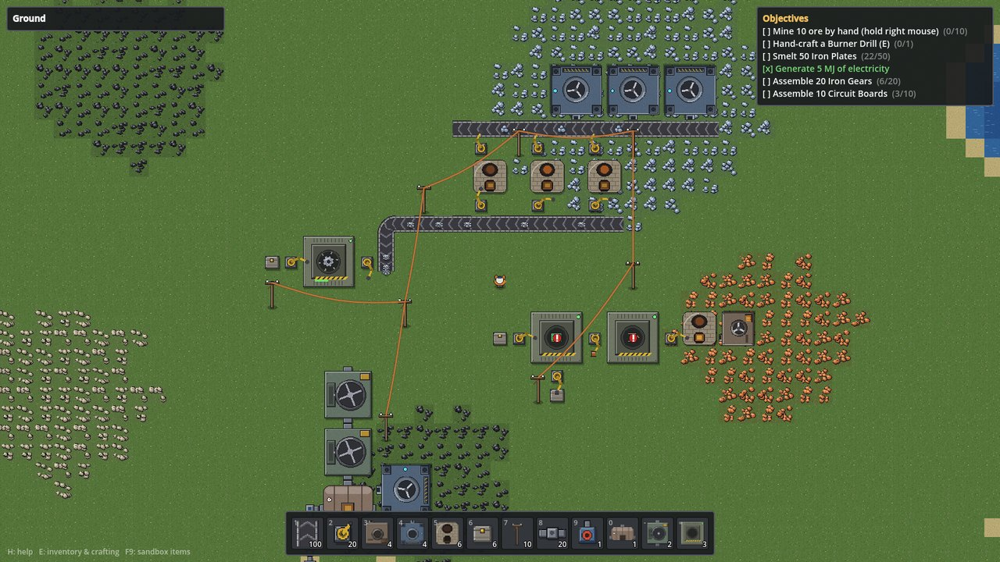
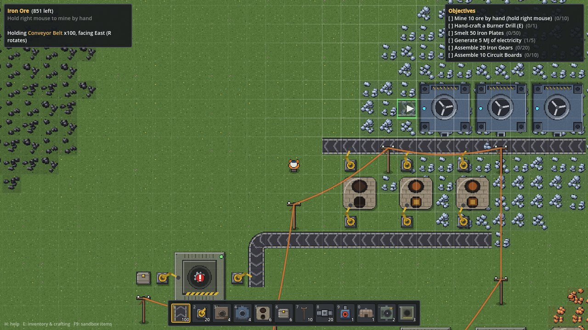

# Factor

A small factory-automation game made in Godot 4. It is a proof of concept for the core loop of
the genre: mine resources, move them on conveyor belts, smelt them, assemble parts, and power
it all with steam.



## Running it

1. Install **Godot 4.5** (standard build, not .NET). It was tested on 4.5.1. Godot 4.3 or newer should also work.
2. Open `project.godot` in the editor and press **F5**, or run `godot --path .` from this folder.
3. Pick a start option:
   - **Demo factory** starts with a working factory that uses every mechanic, plus a kit of buildings to extend it.
   - **From scratch** gives you 2 burner drills, 2 furnaces, some coal and iron plates.

To skip the menu and launch straight into the demo, run `godot --path . -- --demo`.

## What's included

I picked the content from the entities you use in the first hour of a Factorio-style game: the
smallest set that still covers the full mine → belt → smelt → assemble → power chain.

### Buildings (12)

| Building | Size | Energy | What it does |
|---|---|---|---|
| Conveyor Belt | 1×1 | – | Moves items at 1.875 tiles/s. Curves and side-loading are automatic. |
| Inserter Arm | 1×1 | 13 kW electric | Moves items from the tile behind it to the tile in front. Only picks up items the target can use, and fuel comes first when a machine runs out. |
| Burner Drill | 2×2 | 150 kW coal | Mines the ore underneath it at 0.25/s and outputs to the front-left tile. |
| Electric Drill | 3×3 | 90 kW electric | Mines a 5×5 area at 0.5/s and outputs to the front-centre tile. |
| Stone Furnace | 2×2 | 90 kW coal | Smelts ore into plates and stone into bricks. It picks the recipe from its input. |
| Assembler | 3×3 | 75 kW electric | Crafts whichever recipe you choose in its window, at 0.75× speed. |
| Storage Chest | 1×1 | – | Holds 16 stacks. |
| Water Pump | 1×1 | – | Goes on the shore with water behind it and pumps 1200 water/s. |
| Pipe | 1×1 | – | Connects fluid ports on all four sides. |
| Boiler | 3×2 | 1.8 MW coal | Water enters at the sides and steam (60/s) leaves the front. |
| Steam Engine | 3×3 | – | Turns 30 steam/s into up to 900 kW. Ports at both ends let engines chain. |
| Power Pole | 1×1 | – | Powers a 7×7 area and wires itself to poles within 8 tiles. |

### Items (10 materials and 1 tool, plus the buildings above)

- **Raw:** Iron Ore, Copper Ore, Coal (fuel, 4 MJ), Stone
- **Smelted:** Iron Plate, Copper Plate, Stone Brick
- **Intermediate:** Iron Gear, Copper Wire, Circuit Board
- **Tool:** Repair Kit (1 Circuit Board + 2 Iron Gears, 1 s). Each kit restores 200 health.

All recipes are in `scripts/core/game_data.gd`. For example: belts use a plate and a gear, inserters
use a circuit, a gear and a plate, and boilers need stone bricks, so you have to smelt stone.

### Mechanics

- **Tight grid:** Everything snaps to 32 px tiles. The grid only appears while you hold
  something to place. It is faint across the screen and brighter around the cursor, and the ghost
  shows green or red, the facing arrow, drill areas, output tiles and pole coverage.
  
- **Resources:** Ore is finite and stored per tile. You can mine it by hand (hold right mouse) or
  with drills, and both use it up.
- **Belts:** Belts have a single lane and hold 4 items per tile. Items queue up without
  overlapping. Belts curve on their own and accept items from the side. The whole belt network
  updates downstream-first, so a full line moves as one.
- **Inserters, drills and furnaces** feed each other directly, the same way inserters feed
  burner drills, boilers and assemblers.
- **Power:** Poles connect into networks. Each tick a network compares the demand of the
  machines in its supply area with what its steam engines can produce. When there isn't enough
  power, every machine on the network slows down.
- **Fluids:** Connected pipes and fluid ports form one shared pool. Water and steam never mix.
  If you connect them, that pipe network is blocked and reports why.
- **Crafting:** Hand-crafting fills in missing intermediates for you. For example, crafting
  belts also crafts the gears they need. You get a crafting queue, and assemblers can run any
  hand recipe.
- **Wear and repair:** Drills, furnaces, assemblers, pumps, boilers and steam engines lose
  health while they work, and go from full to broken in 30 minutes of continuous work. A health
  bar appears below 75%, a wrench icon blinks below 25%, and at 0 the machine stops. Hold a
  Repair Kit (F) and hold left mouse on the machine to repair it at 60 health per second.
  Belts, inserters, poles, pipes and chests don't wear. A machine you pick up while damaged
  stays damaged when you place it again, so picking it up isn't a free repair. In the demo, the
  copper burner drill starts nearly worn out and breaks after a few minutes. Set `WEAR_SECONDS`
  in `game_data.gd` to change the wear rate, or to 0 to turn wear off.
- **Feedback:** Machines blink an icon when they are out of fuel, power or ingredients. Hover
  over anything to see its status, and use the objectives panel to follow the progression.

## Controls

| Input | Action |
|---|---|
| WASD / arrow keys | Walk |
| Mouse wheel | Zoom |
| 1 – 0, `-`, `=` | Pick a building from the hotbar |
| F | Hold a Repair Kit |
| Left click | Place (hold and drag to lay a belt line) / open a building. With a Repair Kit, hold to repair |
| Right click (hold) | Mine ore by hand, or pick up a building along with its contents |
| R / Shift+R | Rotate the held building, or the hovered one |
| Q | Copy the hovered building into your hand / empty your hand |
| E or Tab | Inventory and hand crafting (click = 1, Shift+click = 5) |
| H or F1 | Help |
| Esc | Close windows / empty your hand |
| F9 | Sandbox: add 20 of every building and Repair Kit |

## Project layout

```
project.godot
scenes/main.tscn            entry scene (scripts/main.gd builds everything else)
scripts/
  main.gd                   game controller: input, placing, mining, start menu flow
  core/game_data.gd         autoload: items, recipes, buildings, input map, stats
  core/inventory.gd         slot-limited item storage
  core/burner_fuel.gd       fuel slot used by burner drill, furnace, boiler
  world/world.gd            map generation, placement rules, simulation tick, demo layout
  world/*_renderer.gd …     batched drawing for belts, belt items and wires
  entities/*.gd             one script per building type (all extend Building)
  systems/power_*.gd        electric networks
  systems/fluid_*.gd        fluid boxes and pools
  player/player.gd          movement, collision, recursive hand crafting
  ui/hud.gd                 all screen UI, built in code
  ui/build_preview.gd       placement grid, ghost and hover highlights
assets/                     generated sprites and icons (see below)
tests/test_runner.tscn      headless simulation tests
tools/generate_sprites.py   regenerates every sprite
tools/screenshot.tscn       captures screenshots of the running demo
```

To add a building, add an entry to `BUILDINGS`, `ITEMS` and `RECIPES` in `game_data.gd`, write a
script in `scripts/entities/` that extends `Building`, and add a sprite.

## Tests

The simulation runs headless. It is covered by tests for belts (movement, compression, curves,
side-loading), inserter → furnace → chest chains, fluid rules, recursive hand crafting, and wear
and repair. There is also a 2-minute run of the demo factory that checks power, fuel, gears and
circuits.

```bash
godot --headless --path . --import
godot --headless --path . res://tests/test_runner.tscn
```

The process exits with the number of failed checks, so 0 means every check passed.

## Art and licence

There are no third-party assets. Every sprite and icon is pixel art drawn by
`tools/generate_sprites.py` (requires Pillow) and released under CC0, see `assets/LICENSE.md`.
Run `python3 tools/generate_sprites.py` to regenerate them. To use other art, such as one of the
CC0 packs from Kenney, replace the PNGs in `assets/sprites` and `assets/icons` with files of the
same name and size. Building sprites face north, and the game rotates them.

## Deliberate simplifications

This is a proof of concept. Belts have one lane instead of two. There are no items on the
ground, so a drill with nowhere to output keeps up to 10 ore inside itself for you to collect. It
does not have splitters, underground belts, research, enemies or saving. The demo's furnaces and
burner drill start with coal and run for roughly 15 to 30 minutes before they need topping up. The
boiler never needs it, because an electric drill keeps it fed.
